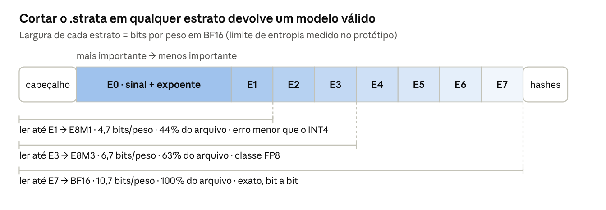
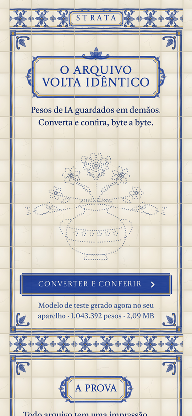

# STRATA

**Um formato de arquivo para pesos de IA que guarda só o que não dá para prever.** Cada estrato refina o anterior, cada modelo-filho guarda só a diferença para o pai, e o arquivo volta bit a bit para o `.safetensors` original.



## A ideia em três linhas

- **Um arquivo, todas as precisões.** Os bits de cada peso viram camadas em ordem de importância. Ler só o começo do arquivo dá um modelo de 4 a 7 bits; ler tudo dá o original exato. Hoje, cada precisão é um arquivo separado.
- **Uma família, não cópias.** Um fine-tune aponta o modelo-base e guarda só a diferença.
- **Sem perdas por padrão.** A conversão a partir do `.safetensors` é direta e volta byte a byte, conferida pelo SHA-256.

O ganho grande não vem de espremer um modelo (sem perdas, o teto fica perto de 30%), e sim de parar de guardar o mesmo modelo várias vezes: um único repositório do Hugging Face guarda 29 versões do mesmo modelo de 9 bilhões de pesos, somando 191 GB.

## O que o protótipo provou

Medido num modelo sintético BF16 de 1.000.192 pesos (semente 7), com o código deste repositório:

| | Resultado |
| --- | --- |
| Volta para `.safetensors` | SHA-256 idêntico, byte a byte |
| Tamanho do `.strata` | 70,0% do original (o teto teórico fica perto de 67%) |
| Lendo só 46,5% do arquivo (E8M1) | erro de 10,95%, contra 14,48% de um INT4 por bloco |
| Fine-tune guardado como diferença do pai | 24,7% do tamanho do filho guardado sozinho |
| Informação no expoente | 2,70 bits dos 8 que ele ocupa |

Os pesos são sintéticos (caudas pesadas e canais atípicos, como num LLM), então os números servem para comparar opções, não para prometer ganhos. Tabelas completas, outras sementes e um modelo 4× maior em [docs/05-resultados.md](docs/05-resultados.md).

## Experimente

**A página.** [`dist/strata-lab.html`](dist/strata-lab.html) é um arquivo só, sem servidor. Baixe e abra no navegador: ela gera um modelo de teste no aparelho, converte para `.strata`, volta para `.safetensors` e confere o SHA-256, pintando o resultado num painel de azulejos. Nada sai do aparelho.

<p>
  
  
</p>

**Os testes** (Node 18 ou mais novo):

```
node tests/test-lab.mjs     # o pipeline da página: tabela por estrato e seis conferências
node tests/test-core.mjs    # o codec: modelos de 1 M e 4 M pesos, prefixos e bordas de tipos
node tests/test-rans.mjs    # o rANS do expoente; com um .safetensors no fim, mede e confere um modelo real
node tests/test-seguranca.mjs   # o leitor contra arquivos hostis, os hashes e os vetores públicos
node tests/fuzz-leitor.mjs      # fuzzing do leitor; com --rust, compara com o leitor em Rust caso a caso
node tests/test-shards.mjs      # modelos em vários .safetensors: um .strata por shard ou arquivos por estrato
python3 build.py            # monta dist/strata-lab.html a partir de src/
```

**O leitor de referência** (Rust 1.87 ou mais novo) valida, decodifica e confere um `.strata`, ou reconstrói o `.safetensors`:

```
cd leitor-rs && cargo test --release && cargo build --release
./target/release/strata-ref confere modelo.strata
./target/release/strata-ref volta modelo.strata modelo.safetensors
./target/release/strata-ref fluxo modelo.strata    # lê em pedaços, como num download
./target/release/strata-ref residual modelo.safetensors Q4_K_M.gguf modelo.strata   # modo residual (0.3)
./target/release/strata-ref gguf modelo.strata Q4_K_M.gguf   # o GGUF de volta, só do estrato 0
./target/release/strata-ref distribui Q4_K_M.gguf pasta model-0000*.safetensors --index model.safetensors.index.json   # níveis e fecho ao lado de um GGUF publicado
./target/release/strata-ref junta pasta/model.strata.index.json saida --base Q4_K_M.gguf   # os shards originais de volta
```

**Em Python** o mesmo leitor é usado como o safetensors (Python 3.11 ou mais novo; precisa do Rust para compilar):

```
cd leitor-py && pip install maturin && maturin develop --release
python -m pytest tests -q
```

```python
import strata_ref
pesos = strata_ref.load_file("modelo.strata", framework="pt")    # dict nome -> torch.Tensor, conferido
with strata_ref.safe_open("modelo.strata", framework="numpy") as f:
    w = f.get_tensor("model.norm.weight", prof=3)                 # só 3 planos de mantissa
strata_ref.abre_cabecalho("modelo.strata").bytes_ate(3)          # quantos bytes baixar para ler com 3 planos
pesos = strata_ref.load_url("https://.../modelo.strata", framework="pt", prof=3)  # decodifica enquanto baixa
```

Dá para rodar tudo pelo navegador, sem instalar nada no computador: abra o repositório num Codespace do GitHub e use o terminal dele.

## Documentação

| Documento | Para quem quer |
| --- | --- |
| [01 · Pesquisa](docs/01-pesquisa.md) | entender o problema, o estado da arte e a proposta |
| [02 · Especificação do formato](docs/02-especificacao-formato.md) | ler ou escrever um `.strata`: layout binário, cabeçalho, prefixos, exemplo byte a byte e extensões propostas |
| [03 · Fórmulas](docs/03-formulas.md) | conferir a matemática: regra da cadeia, custo por estrato, ponto médio, métricas, genealogia |
| [04 · Protótipo](docs/04-prototipo.md) | saber como a página funciona e como foi desenhada |
| [05 · Resultados](docs/05-resultados.md) | ver todos os números medidos e o que eles não provam |
| [06 · Histórico](docs/06-historico.md) | acompanhar como tudo foi feito, as revisões e as decisões |
| [DESIGN.md](DESIGN.md) | o sistema visual do painel de azulejos |
| [video/README.md](video/README.md) | o padrão dos vídeos explicativos (9:16, narração, transições 3D) |
| [PRODUCT.md](PRODUCT.md) | o contexto de produto do protótipo |

## O que tem aqui

```
docs/                     pesquisa, especificação, fórmulas, protótipo, resultados, histórico
docs/img/                 diagrama, gráfico e capturas do protótipo
src/strata-core.js        codec: separa os campos, monta e lê o .strata (validado e com hashes), mede o erro
src/strata-lab.js         pipeline da demonstração (roda num Web Worker)
src/strata-pincel.js      pinta na hora os azulejos, frisos, molduras e botões da página
src/strata-lab.src.html   a página, antes da montagem
dist/strata-lab.html      a página montada, pronta para abrir (≈153 KB)
build.py                  injeta os scripts na página e gera dist/
tests/                    testes do codec, do pipeline completo e da segurança do leitor
tests/vetores/            vetores públicos: .strata válidos e hostis com o resultado esperado
leitor-rs/                leitor de referência em Rust (biblioteca e linha de comando strata-ref)
leitor-py/                o leitor de referência em Python (binding do Rust, API como a do safetensors)
video/                    padrão dos vídeos explicativos: regras, exemplo e scripts de render
DESIGN.md, .impeccable/   sistema de design e contrato de direção
PRODUCT.md                contexto de produto
```

## Estado

- **Implementado (`strata/0.2`):** estratos de sinal, expoente e cada bit da mantissa em ordem estrato-maior; rANS determinístico no expoente; leitura por prefixo; reconstrução no ponto médio; volta bit a bit para `.safetensors`; BF16, FP16, FP32, FP8 e inteiros; leitor que recusa arquivo malformado ou hostil e SHA-256 por stream, por tensor e do original, em dois leitores independentes (JS e Rust). Ver a [seção 18 dos resultados](docs/05-resultados.md#18-segurança-do-leitor).
- **Medido num modelo real:** no Llama-3.2-1B, o `.strata` sem perdas tem 10,59 bits/peso (66% do BF16) e volta com SHA-256 idêntico; o ΔPPL de cada estrato no wikitext-2 está em [`tests/ppl/`](tests/ppl) e a comparação com INT-k na [seção 12 dos resultados](docs/05-resultados.md#12-rans-no-expoente-num-modelo-real-llama-32-1b).
- **Medido, mas ainda não gravado no arquivo:** a genealogia (o filho como diferença do pai).
- **Implementado (`strata/0.3`, modo residual):** o estrato 0 é o GGUF Q4_K_M byte a byte, os níveis seguintes refinam a célula de cada peso e o último fecha o BF16 exato. No Llama-3.2-1B o arquivo tem 11,12 bits/peso e volta com o SHA-256 dos dois originais. Ver a [seção 21 dos resultados](docs/05-resultados.md#21-modo-residual-gravado-strata03).
- **Distribuição sobre o GGUF do Hub:** o Q4_K_M publicado fica intacto como estrato 0, e os níveis e o fecho vão em arquivos ao lado. No Llama-3.1-8B-Instruct (Q4_K_M com imatrix do bartowski) o conjunto tem 11,13 bits/peso, 11,18 GB contra 33,31 GB de BF16 + Q4_K_M + Q5_K_M + Q6_K, e volta aos 4 shards com o SHA-256 do Hugging Face. Os níveis 1 e 2 ainda perdem para os k-quants do mesmo tamanho. Ver a [seção 31 dos resultados](docs/05-resultados.md#31-distribuição-sobre-o-gguf-do-hub-llama-31-8b-instruct).
- **Proposto, sem código:** codec por bloco, árvore Merkle por bloco, rANS intercalado para decodificar na GPU e um adaptador que apresenta o `.strata` como `.safetensors`.
- **Próximo passo:** comparar os cortes contra Q4_K_M e Q5_K_M do llama.cpp nos mesmos tokens. O roteiro completo está na [pesquisa](docs/01-pesquisa.md#roteiro-de-validação).

## Limites

- A página e as seções 1 a 9 dos resultados usam um modelo sintético e medem o erro nos pesos. O único modelo real medido até agora é o Llama-3.2-1B (ΔPPL e tamanho).
- O rANS é de ordem 0 e só no expoente; os planos da mantissa continuam em deflate. Contexto renderia cerca de 0,07 bit por peso a mais.
- Mesmo com o mesmo codificador de entropia dos dois lados, um INT-k por bloco atinge o mesmo ΔPPL com 0,4 a 0,5 bit por peso a menos que o corte do STRATA.
- Perto de 8 bits, o INT8 por bloco erra menos que o corte equivalente do STRATA. O modo residual fecha essa diferença nos níveis intermediários, mas rodá-los precisa de um kernel que ainda está em desenvolvimento.
- A linha "≈13 GB num `.strata`" da página é uma estimativa e aparece marcada como tal.

---

Pesquisa, formato e protótipo criados por Cantyll com o Claude, em outubro de 2026. Fontes da pesquisa em [docs/01-pesquisa.md](docs/01-pesquisa.md#fontes).
