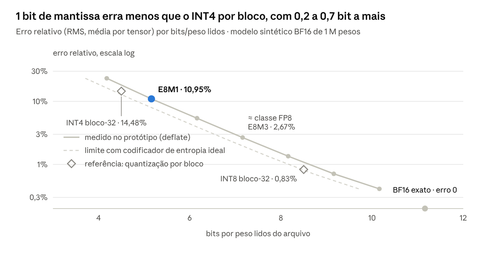

# STRATA — formato estratificado e genealógico para pesos de IA

Pesquisa · 10 de outubro de 2026 · versão de referência deste repositório (a mesma do documento de pesquisa original, com os números do protótipo atualizados).

## Resumo

STRATA é um formato de arquivo para pesos de IA que guarda só a informação que ainda não dá para prever: cada estrato refina o anterior, cada modelo-filho guarda só a diferença para o pai, e o arquivo volta bit a bit para o safetensors original.

- **Um arquivo, todas as precisões.** Os bits viram camadas ordenadas por importância. Ler só o começo do arquivo dá um modelo de 4–7 bits; ler tudo dá o BF16 exato. Hoje cada precisão é um arquivo separado.
- **Uma família, não cópias.** Fine-tunes apontam o modelo-base por hash e guardam só o delta.
- **Sem perdas por padrão.** Conversão direta e reversível de safetensors e GGUF; o protótipo confere SHA-256 idêntico na volta.
- **Ganho realista.** Cerca de 30% num modelo isolado — o teto físico, porque a mantissa é quase ruído. Num repositório de variantes como o gemma-2-9b-it-GGUF, a estimativa passa de 10×: é ali que mora o desperdício.

## O problema em números

O tamanho de um modelo não é o problema maior; a multiplicação dele é.

- **Escala.** Modelos abertos de 1,6 trilhão de parâmetros já existem ([Reuters, via The Standard](https://www.thestandard.com.hk/finance/article/336728/Chinas-MiniMax-plans-to-launch-giant-27-trillion-parameter-model)), e o Kimi K3 saiu em julho de 2026 com 2,8 trilhões ([Tech Insider](https://tech-insider.org/open-source-ai-model-wave-2026/)). Em BF16, 2,8 trilhões de pesos ocupam 5,6 TB.
- **Hubs.** O Hugging Face guardava quase 45 PB em 2 milhões de repositórios em fevereiro de 2025, com mais de 3,5 PB só em arquivos .gguf ([Hugging Face](https://huggingface.co/blog/from-chunks-to-blocks)).
- **Variantes.** Um único repositório, bartowski/gemma-2-9b-it-GGUF, guarda 29 quantizações do mesmo modelo de 9 B, somando 191 GB ([Hugging Face](https://huggingface.co/blog/from-chunks-to-blocks)) — cerca de 10× o original em BF16 (~18,5 GB).
- **Fine-tunes.** Variantes ajustadas superam em muito os modelos-base e dominam o espaço dos hubs, que já somam dezenas de petabytes de LLMs ([ZipLLM, NSDI '26](https://www.usenix.org/conference/nsdi26/presentation/wang-zirui)).

## Como se guarda hoje e onde trava

Os formatos atuais são contêineres de números, não de informação: cada peso ocupa a largura cheia do tipo, seja qual for o conteúdo.

- **safetensors**: 8 bytes com o tamanho do cabeçalho, um JSON com nome, dtype, shape e offsets de cada tensor, e os bytes crus em seguida ([especificação](https://github.com/huggingface/safetensors)). Seguro e mapeável em memória, mas sem nenhuma compressão.
- **GGUF**: quantização por blocos (Q4_K, Q8_0…). Cada nível de precisão é um arquivo inteiro e independente.
- **Compressores genéricos** quase não ajudam em floats: LZ4 e Snappy ganham zero ([ZipNN](https://arxiv.org/html/2411.05239v2)).
- **Deduplicação por blocos** (Xet, pedaços de ~64 KB) só encontra trechos idênticos. Um fine-tune mexe um pouco em quase todos os pesos, e a dedup genérica, cega à estrutura do LLM, rende pouco ([ZipLLM](https://www.usenix.org/conference/nsdi26/presentation/wang-zirui)).

Três premissas prendem tudo isso na caixa: o arquivo é uma foto numa precisão fixa; cada modelo é órfão; e o formato de armazenamento é diferente do formato de execução.

## Estado da arte por eixo

Cada peça que STRATA usa já foi demonstrada isoladamente; nenhum trabalho encontrado junta todas num único formato de arquivo.

| Eixo | Trabalho | Ideia central | Resultado publicado |
| --- | --- | --- | --- |
| Entropia sem perdas | [ZipNN](https://arxiv.org/html/2411.05239v2) (IBM, 2024) | separar o expoente, muito enviesado, e codificar com Huffman | −33% em modelos BF16 |
| Entropia sem perdas | [DFloat11](https://neurips.cc/virtual/2025/poster/115225) (NeurIPS 2025) | BF16 em ~11 bits, decodificado dentro da GPU | −30%, saída bit a bit idêntica; Llama 3.1 405B (810 GB) em 8 GPUs de 80 GB |
| Entropia sem perdas | [ECF8](https://proceedings.iclr.cc/paper_files/paper/2026/hash/57c3fef21638eb9d1d67d32ba0a6d1af-Abstract-Conference.html) (ICLR 2026) | baixa entropia do expoente como lei estatística; versão FP8 | até −26,9% em modelos FP8 de até 671 B |
| Precisão aninhada | [Any-Precision LLM](https://icml.cc/virtual/2024/poster/32846) (ICML 2024) | planos de bits sobrepostos: modelos de 3 a n bits no espaço de um de n bits | um arquivo serve vários tamanhos |
| Precisão aninhada | [Matryoshka Quantization](https://icml.cc/virtual/2025/poster/43985) (ICML 2025) | int2 ⊂ int4 ⊂ int8 pelos bits mais significativos, treinados juntos | int2 até 7% mais preciso que o int2 padrão |
| Execução direta | [TRACE](https://arxiv.org/pdf/2509.03377) (2025) | memória em planos de bits; buscar só os planos necessários | até 40,3% menos energia de DRAM (simulado) |
| Genealogia | [ZipLLM + BitX](https://www.usenix.org/conference/nsdi26/presentation/wang-zirui) (NSDI '26) | XOR entre fine-tune e base, dedup por tensor | −54% no armazenamento de LLMs |
| Genealogia | [BitDelta](https://proceedings.neurips.cc/paper_files/paper/2024/hash/187d94b3c93343f0e925b5cf729eadd5-Abstract.html) (NeurIPS 2024) | delta do fine-tune em 1 bit + escala | mais de 10× menos memória servindo vários fine-tunes |
| Procedural | [SeedLM](https://arxiv.org/abs/2410.10714v2) (ICLR 2025) | bloco de pesos = semente de LFSR + poucos coeficientes | 3–4 bits sem dados de calibração; ~4× mais rápido em FPGA |
| Blocos com escala | [MXFP4](https://www.emergentmind.com/topics/mxfp4) (OCP) | 32 valores E2M1 + 1 escala de 8 bits | 4,25 bits/peso; o gpt-oss-120b cabe em ~80 GB ([HF](https://huggingface.co/blog/faster-transformers)) |
| Estrutura | [CompactifAI](https://arxiv.org/pdf/2401.14109) (2024) | matrizes viram redes tensoriais (MPO) | 30% do tamanho, com re-treino curto |

## A virada: guardar só a surpresa

Todo byte de um arquivo STRATA é informação que o leitor não conseguiria prever com o que já tem: os estratos anteriores, o modelo-pai ou um gerador.

A conta que libera as camadas é a regra da cadeia da entropia. Se o esboço S é função determinística dos pesos W (um arredondamento, uma quantização), então:

```math
H(W) = H(S) + H(W \mid S)
```

Guardar o esboço e depois só o que falta custa, em teoria, o mesmo que guardar W direto. As camadas saem de graça; a sobra prática vem do codificador, não da ideia. É o refinamento sucessivo de Equitz e Cover (1991) aplicado a pesos.

Três eixos de previsão:

1. **Vertical — precisão.** Cada estrato refina o anterior; precisão vira escolha de leitura, não propriedade do arquivo.
2. **Horizontal — linhagem.** O filho é previsto pelo pai; guarda-se só o resíduo.
3. **Representação — geração.** Quando gerar um bloco (semente + coeficientes) sai mais barato que guardá-lo, o bloco vira uma receita declarativa.

A analogia certa é vídeo, não zip:

| Em vídeo | Em STRATA |
| --- | --- |
| Quadro-chave (I-frame) | modelo-base completo |
| Quadro previsto (P-frame) | fine-tune guardado como delta |
| Modo por macrobloco | codec escolhido por bloco de pesos |
| Camadas escaláveis (SVC) | estratos de precisão |
| Streaming progressivo | modelo usável enquanto baixa |

## STRATA — especificação conceitual (v0.1)

Um arquivo .strata tem cabeçalho, estratos em ordem de importância e hashes de integridade; cortar o arquivo em qualquer fronteira de estrato devolve um modelo válido, só que menos preciso.


*Estrutura proposta · larguras do protótipo (BF16, limite de entropia).*

O índice no cabeçalho diz onde cada estrato começa, então o leitor baixa só o prefixo da precisão que quer. O formato binário exato da versão implementada está em [02-especificacao-formato.md](02-especificacao-formato.md).

**Estratos (eixo vertical).** Dois modos:

- *FP-progressivo* (implementado no protótipo): estrato 0 = sinal + expoente com codificação de entropia; estratos 1…m = bits da mantissa, do mais ao menos significativo. Ler k estratos de mantissa equivale a um float E8Mk reconstruído no ponto médio do intervalo.
- *Residual* (proposto): estrato 0 = um quantizador de ponta (GPTQ, AWQ, MXFP4/NVFP4 ou o Q4_K_M de um GGUF existente); os seguintes são resíduos; o último fecha o valor exato como distância em ULPs. Pela regra da cadeia, isso não custa bits extras em teoria.

**Codec por bloco (eixo de representação).** Cada bloco de 4.096 pesos declara o modo mais barato:

| Modo | Quando | Custo aproximado |
| --- | --- | --- |
| HERDA | bloco idêntico ao do pai | ~32 bytes (hash) |
| DELTA | fine-tune do pai | só os estratos do Δ |
| ENTROPIA | modelo-base, sem pai | ~10,7 bits/peso em BF16 |
| SEMENTE | perfil leve, com perda | semente + coeficientes (estilo SeedLM) |
| BRUTO | inteiros ou dados já comprimidos | tamanho original |

**Genealogia (eixo horizontal).** O cabeçalho aponta o pai por hash de conteúdo. Um detalhe muda o desenho: num fine-tune, a informação nova mora nos bits menos significativos, então truncar a precisão do filho apaga o fine-tune. Por isso STRATA estratifica o Δ, não o peso: o estrato 0 do Δ é sinal + escala por bloco — o BitDelta vira caso particular — e um estrato final em XOR garante o filho bit a bit.

**Execução direta.** Blocos de tamanho fixo em elementos e offsets no índice permitem decodificar em paralelo na GPU, como DFloat11 e ECF8 já fazem: o arquivo comprimido é o próprio formato de memória.

**Distribuição.** Com a ordem estrato-maior e o índice no início, requisições HTTP Range buscam só a precisão desejada, blocos endereçados por conteúdo deduplicam no hub, e o download progressivo entrega um modelo que fica mais preciso enquanto baixa.

**Segurança.** Nenhum código executável no arquivo: SEMENTE usa geradores de especificação fixa, como o safetensors fez para escapar do pickle.

## Conversão direta: safetensors/GGUF → .strata → de volta

A conversão é streaming, tensor a tensor, e reversível bit a bit: adotar STRATA não obriga ninguém a abandonar o formato atual.

1. **Ler só o cabeçalho** do safetensors (ou a tabela de tensores do GGUF) e guardar seus bytes originais, intactos.
2. **Achar a família**: hash por tensor; tensores idênticos aos de um pai conhecido viram HERDA.
3. **Separar os campos** de cada float — sinal, expoente, mantissa — em BF16, FP16, FP32 ou FP8. Inteiros e blocos já quantizados entram como BRUTO; num GGUF, o bloco Q4 pode virar o estrato 0 do modo residual.
4. **Fatiar em estratos** e escolher o codec de cada bloco.
5. **Codificar a entropia** de cada estrato com um codificador determinístico (rANS ou Huffman) decodificável na GPU.
6. **Gravar** cabeçalho, índice de offsets por estrato e hash por bloco (árvore Merkle).
7. **Verificar**: decodificar tudo e comparar o SHA-256 com o original. Divergiu, a conversão falha.

Na volta, estratos viram valores, os valores vão para os offsets do cabeçalho original e sai o mesmo arquivo, byte a byte. Ferramentas atuais (transformers, vLLM, llama.cpp) podem ler STRATA por um adaptador que apresenta um safetensors virtual.

## O que o protótipo mediu

Num modelo sintético BF16 de 1 milhão de pesos, o .strata ficou com 70,0% do safetensors e voltou com SHA-256 idêntico; o expoente carregou só 2,70 bits de informação dos 8 que ocupa.



*Medido no protótipo · modelo sintético BF16, 1 M pesos (semente 7).*

Cada ponto é um corte do mesmo arquivo. A curva cheia usa o deflate do navegador, que desperdiça cerca de 0,5 bit/peso no expoente; a tracejada é o limite com um codificador de entropia ideal.

Na genealogia simulada (dois tensores congelados, dois com LoRA de posto 8, dois com ajuste completo), o filho guardado como delta ocupou 24,7% do filho isolado, sem perdas. Truncar os pesos do filho em E8M3 preserva pouco da direção do fine-tune (cosseno 0,27–0,51 com o Δ verdadeiro); um Δ de 1 bit por peso preserva bem mais (0,71–0,93). É a evidência para estratificar o Δ, e não o peso.

Pesos sintéticos com caudas pesadas e canais atípicos imitam LLMs, mas não os substituem: estes números servem para comparar opções, não para prometer ganhos.

O protótipo roda no navegador (ver [04-prototipo.md](04-prototipo.md)). Lá o modelo leva junto um desenho de demonstração de 43 mil pesos, que comprime melhor: o arquivo fica em 68,8%, e o erro mostrado exclui o desenho. A tabela completa por estrato está em [05-resultados.md](05-resultados.md).

## Estimativas de ganho

O ganho grande não vem de espremer um modelo; vem de parar de guardar o mesmo modelo várias vezes.

| Cenário | Hoje | Com STRATA (estimativa) | Base da conta |
| --- | --- | --- | --- |
| Repositório de quantizações (gemma-2-9b-it-GGUF) | 191 GB em 29 arquivos (97 GB com Xet) | ~12–13 GB em 1 arquivo: precisão contínua + original exato | 9,24 B pesos × 10,7–11,2 bits |
| Fine-tune de base conhecida | 100% do filho | só o Δ: 25% no protótipo; −54% medido em hub real pelo ZipLLM | HERDA + XOR por estrato |
| 1 trilhão de pesos em BF16 | 2,0 TB | ~1,34 TB, com todas as vistas de precisão dentro | 10,7 bits/peso |
| Um modelo BF16 isolado | 100% | 67–70% | limite da mantissa; 70% medido no protótipo |
| Um modelo FP8 nativo | 100% | ~75–85% | ECF8 chegou a −26,9% |
| Baixar para rodar em ~4–5 bits | outro arquivo, separado | os primeiros 44–47% do mesmo .strata | prefixo E0 + E1 |

Limites honestos:

- Sem perdas, um modelo BF16 não cai muito abaixo de 67%: os 7 bits de mantissa são quase ruído. Quem promete mais está jogando informação fora.
- Quanto mais o modelo já nasce comprimido (FP8, MXFP4), menor o ganho por modelo — e mais o valor de STRATA migra para os eixos de variantes e linhagem.
- As vistas FP-progressivas custam um pouco mais por bit que quantizadores de ponta; o modo residual existe para fechar essa diferença.

## Horizonte: ideias mais radicais

O formato comporta estas apostas sem mudar a base; nenhuma foi validada em LLMs grandes.

- **Peso como função contínua.** Uma rede pequena gera os pesos a partir de coordenadas — o [NeRN](https://iclr.cc/virtual/2023/poster/11919) fez isso com redes convolucionais. Em STRATA, seria um codec SEMENTE treinado, com estratos de resíduo garantindo a exatidão.
- **Redes tensoriais como esboço.** Matrizes reescritas como MPO ([CompactifAI](https://arxiv.org/pdf/2401.14109)) viram o estrato 0 de um arquivo com perda controlada.
- **Dicionário universal do hub.** Tabelas de entropia e codebooks treinados uma vez sobre milhares de modelos e referenciados por hash, como os dicionários do zstd. Hipótese: todo modelo novo já nasce menor.
- **Arquivo = memória = cálculo.** [TRACE](https://arxiv.org/pdf/2509.03377) (planos de bits na memória CXL) e [Huff-LLM](https://arxiv.org/pdf/2502.00922) (pesos comprimidos até o buffer do chip) apontam para hardware que lê só os planos necessários.
- **Gerar enquanto baixa.** Começar a inferência com o estrato 0 e refinar à medida que os outros chegam; o [LeanStream](https://arxiv.org/pdf/2609.03079) (MobiCom '26) já faz um streaming "especular e refinar" no celular.

## Riscos e perguntas abertas

O maior risco não é técnico, é de adoção: ninguém troca de formato por 30%, então a volta bit-exata e a compatibilidade precisam vir de fábrica.

| Risco | Por que importa | Saída proposta |
| --- | --- | --- |
| Adoção | o ecossistema inteiro lê safetensors e GGUF | volta bit-exata + adaptador de safetensors virtual |
| Vazão de decodificação | códigos de tamanho variável são difíceis de paralelizar | blocos de tamanho fixo + índice; kernels como os de DFloat11 e ECF8; estrato 0 num formato nativo de GPU (MXFP4/NVFP4) |
| Qualidade das vistas intermediárias | E8Mk por truncamento é menos eficiente que GPTQ ou AWQ | modo residual com esboço de ponta |
| Cadeia de dependência | o filho não serve sem o pai | hash de conteúdo, cache de bases, quadro-chave a cada N gerações, exportação autônoma |
| Licença do pai | um delta de modelo restrito exige o pai | o delta não carrega pesos do pai; o leitor checa a licença pelo hash |
| mmap e acesso aleatório | dados comprimidos não mapeiam direto na memória | índice por bloco ou decodificação única para um cache local |
| Determinismo | o hash precisa bater em qualquer máquina | codificador só com inteiros e vetores de teste públicos |

Pergunta aberta central: quanto da qualidade de um fine-tune real sobrevive no Δ de 1 bit? O protótipo sugere bastante (cosseno 0,71–0,93 com o Δ verdadeiro), mas só um teste de perplexidade decide.

## Roteiro de validação

Tudo cabe no navegador: o protótipo roda dentro da própria página, e as fases seguintes usam Google Colab ou Kaggle, sem instalar nada local.

1. **Protótipo (feito).** Conversor safetensors → .strata → safetensors no navegador, com SHA-256 na volta, vistas progressivas e genealogia simulada. Portão: bit-exato em arquivos reais pequenos.
2. **Medir num modelo real.** Qwen3-0.6B ou Llama-3.2-1B no Colab: tamanho por estrato e perplexidade no WikiText-2 de E8M1 a E8M7, contra Q4_K_M e Q8_0. Portão: E8M3 a menos de 1% da perplexidade do BF16.
3. **Codificador de verdade.** rANS determinístico + kernel Triton que decodifica estratos na GPU, comparado ao DFloat11. Portão: tamanho a ±1% da entropia e decodificação mais rápida que ler do SSD.
4. **Genealogia em escala.** 50 fine-tunes de uma família (por exemplo, Llama-3.1-8B): proporção HERDA/DELTA, Δ de 1 bit e perplexidade. Portão: Δ médio abaixo de 30% do tamanho do filho.
5. **Compatibilidade.** Leitor que expõe .strata como safetensors virtual para transformers e vLLM. Portão: carregar sem mudar uma linha do código de quem usa.

## Fontes

- [ZipNN: Lossless Compression for AI Models](https://arxiv.org/html/2411.05239v2) · [blog da IBM Research](https://research.ibm.com/blog/Zip-NN-AI-compression)
- [DFloat11 — 70% Size, 100% Accuracy (NeurIPS 2025)](https://neurips.cc/virtual/2025/poster/115225)
- [ECF8 — To Compress or Not? (ICLR 2026)](https://proceedings.iclr.cc/paper_files/paper/2026/hash/57c3fef21638eb9d1d67d32ba0a6d1af-Abstract-Conference.html)
- [ZipLLM + BitX (NSDI '26)](https://www.usenix.org/conference/nsdi26/presentation/wang-zirui)
- [BitDelta (NeurIPS 2024)](https://proceedings.neurips.cc/paper_files/paper/2024/hash/187d94b3c93343f0e925b5cf729eadd5-Abstract.html)
- [Any-Precision LLM (ICML 2024)](https://icml.cc/virtual/2024/poster/32846)
- [Matryoshka Quantization (ICML 2025)](https://icml.cc/virtual/2025/poster/43985)
- [SeedLM (ICLR 2025)](https://arxiv.org/abs/2410.10714v2)
- [MXFP4 — formato de microescala](https://www.emergentmind.com/topics/mxfp4) · [gpt-oss no transformers](https://huggingface.co/blog/faster-transformers)
- [CompactifAI](https://arxiv.org/pdf/2401.14109)
- [NeRN (ICLR 2023)](https://iclr.cc/virtual/2023/poster/11919)
- [TRACE](https://arxiv.org/pdf/2509.03377) · [Huff-LLM](https://arxiv.org/pdf/2502.00922) · [LeanStream](https://arxiv.org/pdf/2609.03079)
- [Hugging Face — From Chunks to Blocks](https://huggingface.co/blog/from-chunks-to-blocks) · [Xet na documentação do Hub](https://huggingface.co/docs/hub/xet/index)
- [Especificação do safetensors](https://github.com/huggingface/safetensors)
- [Reuters via The Standard — modelos de 1,6 trilhão](https://www.thestandard.com.hk/finance/article/336728/Chinas-MiniMax-plans-to-launch-giant-27-trillion-parameter-model) · [Tech Insider — Kimi K3](https://tech-insider.org/open-source-ai-model-wave-2026/)
