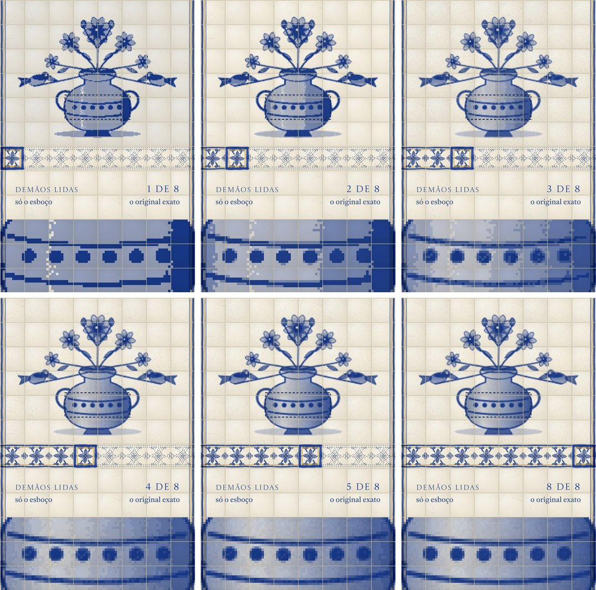
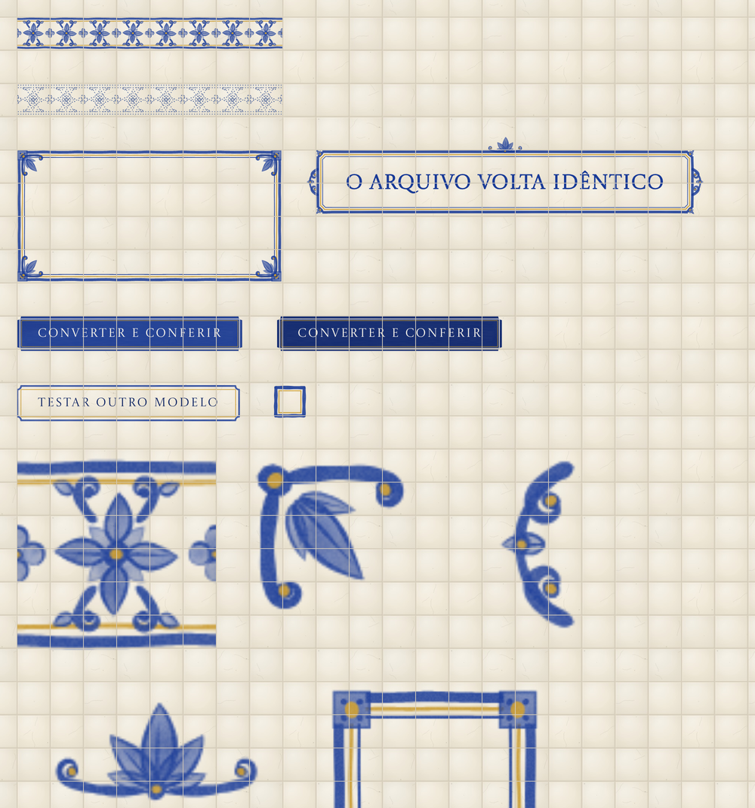
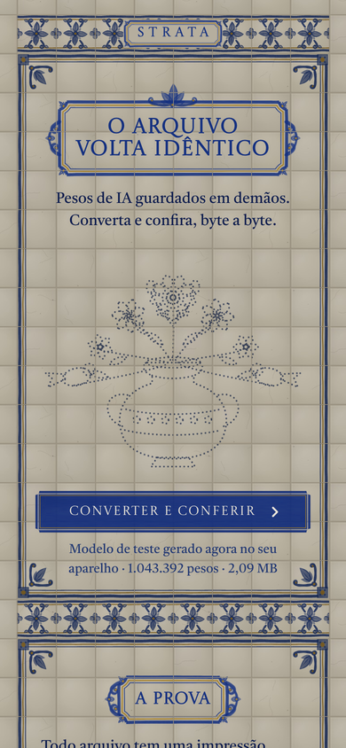
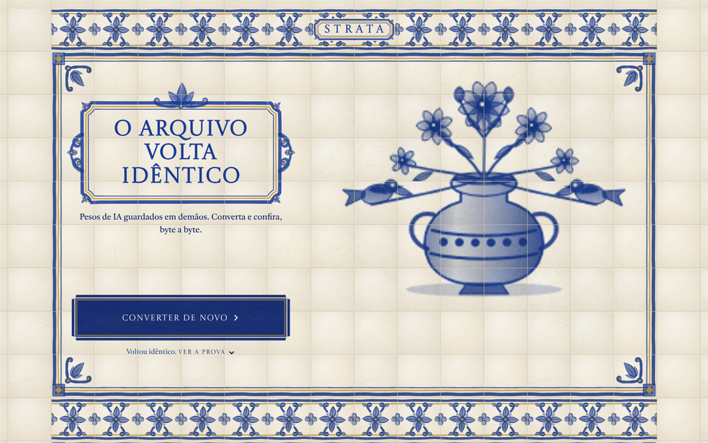

# O protótipo: Painel STRATA

Uma página única, sem servidor e sem instalação, que prova a promessa central do formato: **o arquivo volta idêntico**. Ela gera um modelo de teste no próprio aparelho, converte para `.strata`, volta para `.safetensors` e confere o SHA-256, com o resultado pintado como um painel de azulejos.

- Arquivo pronto: [`dist/strata-lab.html`](../dist/strata-lab.html) (≈127 KB, tudo embutido).
- Público pensado: plateia leiga ou investidores, no celular, abrindo um link recebido.
- Dados: sintéticos, gerados na hora. Nada sai do aparelho.


## Como abrir

- **Pelo navegador:** baixe `dist/strata-lab.html` e abra o arquivo. Funciona no Chrome, no Edge, no Safari 16.4 ou mais novo e no Firefox 113 ou mais novo (precisa de `CompressionStream`).
- **Sem internet:** funciona. Só as fontes (Castoro, do Google Fonts) caem para Georgia.
- **Versão publicada:** o mesmo arquivo foi publicado como página do Claude (privada ao dono até ser compartilhada).

## Arquivos

| Arquivo | Papel |
| --- | --- |
| [`src/strata-core.js`](../src/strata-core.js) | Codec: separa sinal, expoente e planos de mantissa; comprime; monta e lê o `.strata`; reconstrói o safetensors; métricas; genealogia; modelo sintético |
| [`src/strata-lab.js`](../src/strata-lab.js) | Pipeline da demonstração, pensado para rodar num Web Worker: `prepare()` e `convert()` |
| [`src/strata-pincel.js`](../src/strata-pincel.js) | "Pincel": pinta na abertura da página os azulejos, frisos, molduras, cartelas e placas, no tamanho real do azulejo e nas cores do tema |
| [`src/strata-lab.src.html`](../src/strata-lab.src.html) | A página: estrutura, estilos, interface, desenho da albarrada, animações |
| [`build.py`](../build.py) | Injeta os três scripts na página e gera `dist/strata-lab.html` |
| [`tests/test-core.mjs`](../tests/test-core.mjs) | Testa o codec no Node: ida e volta, prefixo, bordas FP16/FP32/FP8/inteiros |
| [`tests/test-lab.mjs`](../tests/test-lab.mjs) | Roda o pipeline completo da página no Node e confere os números |

## O que acontece quando a pessoa toca em "Converter e conferir"

```
página                                   worker (strata-lab.js + strata-core.js)
──────                                   ──────────────────────────────────────
abre ─────── prepare(semente 7) ───────▶ gera 1.000.192 pesos BF16 + o desenho (43.200 pesos)
                                         monta o .safetensors (2,09 MB) e calcula o SHA-256
     ◀────── prepared ──────────────────
toque ────── convert ──────────────────▶ lê o safetensors ............................ "lido"
                                         separa sinal, expoente e mantissa ........... "separado"
                                         comprime cada stream ........................ "comprimido"
     ◀────── progress "camadas" ──────── decodifica o desenho de 8 prefixos do arquivo
pinta a albarrada demão a demão          (os buffers vão por transferência, sem cópia)
     ◀────── "remontado" ─────────────── decodifica tudo e remonta o safetensors
     ◀────── "conferido" ─────────────── SHA-256 da volta + comparação byte a byte
     ◀────── "medido" ────────────────── erro por estrato, INT4/INT8 de referência
                                         simula um fine-tune e mede o filho como delta
     ◀────── done (resultados) ─────────
preenche prova, demãos, família, escala
```

- A pintura acontece **enquanto** o resto do pipeline roda: cada demão é o desenho decodificado de um prefixo do arquivo recém-escrito, com a placa "Demão k de 8 · +X KB lidos".
- Se o navegador não deixar criar o Web Worker (política de segurança, por exemplo), a página roda o mesmo código na thread principal. Os dois caminhos foram testados.
- A primeira tela mostra o tamanho do modelo gerado; em caso de falha, a placa vira "Tentar de novo".

## As seções da página

| Seção | O que mostra | De onde vem |
| --- | --- | --- |
| **O arquivo volta idêntico** | Painel 8×6 com o risco pontilhado de uma albarrada (jarra de flores com pássaros), pintado demão a demão durante a conversão | O desenho é um tensor do próprio modelo de teste, decodificado de cada prefixo |
| **A prova** | Os 64 caracteres do SHA-256 do original e da volta, cada um um azulejo no tom do seu valor, conferidos par a par até o selo **IDÊNTICO**; tamanhos em fileiras de azulejos | `shaOrig`, `shaBack`, tamanhos medidos |
| **Quanto ler é escolha sua** | Um friso de 8 azulejos é o controle: azulejos lidos aparecem pintados, os não lidos só no risco. Ao tocar, repintam o painel, uma lupa 3× do vaso (com a contagem de tons) e os números (% do arquivo, erro, frase) | Prefixos, erro por estrato, comparação com INT4 |
| **Um ajuste guarda só o que mudou** | Filho guardado sozinho × como diferença do pai, e a lista de partes (herdada, ajuste leve, ajuste completo) | Genealogia simulada |
| **Hoje, um modelo vira 29 arquivos** | Paredes de azulejos onde cada azulejo é 1 GB: 191 GB, 97 GB com deduplicação, ≈13 GB num `.strata` (estimativa, hachurada) | Hugging Face (fev. 2025) e os bits por peso medidos na página |
| **Funciona de verdade** | Fecho e "Testar outro modelo" (nova semente, converte de novo) | — |




## Desenho da interface

A direção foi escolhida pelo usuário entre as propostas do plugin de design (Impeccable): **painel de azulejos de estação** (como a escolha foi feita está em [06-historico.md](06-historico.md)). O sistema completo está em [`DESIGN.md`](../DESIGN.md) e [`.impeccable/design.json`](../.impeccable/design.json); o briefing e o contrato de direção, em [`.impeccable/surfaces/strata-lab-html.md`](../.impeccable/surfaces/strata-lab-html.md).

- **A metáfora:** cada bloco de pesos é um azulejo e cada estrato, uma demão de cobalto. Azulejo em branco (só o risco) = ainda não pintado; cobalto = lido ou conferido.
- **Cores:** cobalto sobre branco-leite vidrado (`#183A97` sobre `#EEE7D7`); mostarda (`#C99A2E`) só dentro de molduras e volutas. O tema escuro, "meia-luz", é o mesmo vidrado com a luz baixa (`#B5AE9E`), sem inverter.
- **Tipos:** Castoro Titling para inscrições em maiúsculas; Castoro para o texto.
- **A parede:** a página inteira é azulejada. O lado do azulejo vem da largura: 8 colunas no celular, 14 a partir de 960 px, limitado pela altura para que a primeira tela caiba inteira, e arredondado para pixels inteiros. Todo bloco de conteúdo é ajustado para ocupar fiadas inteiras, então rejuntes, frisos e painéis sempre se alinham.
- **Rejunte por cima, letras por cima do rejunte:** uma camada de rejunte passa sobre pinturas e molduras, como numa parede de verdade; textos e azulejos de dados ficam acima dela, com um halo do próprio vidrado, para nunca parecerem riscados.
- **Pintura em "multiplicar":** as pinturas são cobalto sobre branco compostas em `mix-blend-mode: multiply`, então o brilho, a almofada e o craquelê do vidrado aparecem por baixo da tinta.
- **Ornamentos pintados, não desenhados em CSS:** o `strata-pincel.js` gera, a cada tamanho de azulejo e tema, as imagens dos azulejos do fundo, do friso (pintado e em risco), das cantoneiras, das molduras e cartelas (9 fatias, via `border-image`), do florão, das volutas, das placas (botões) e do seletor. Traço que engorda depois do toque e afina ao levantar, aguada com manchas e tinta acumulada na borda, grão de pincel. Nenhuma imagem externa é usada.



- **Movimento:** lavagem diagonal de cobalto azulejo por azulejo a cada demão, carimbo no selo, pulso na etapa atual. Tudo desligado com "reduzir movimento".
- **Acessibilidade:** o friso de demãos é um `input type="range"` nativo (teclado, leitor de tela e `aria-valuetext` "2 de 8 demãos"); pinturas têm descrições que mudam com o estado; contraste AA nos dois temas; foco visível.

| Celular, meia-luz | Computador |
| --- | --- |
|  |  |

Páginas inteiras: [celular](img/prototipo-celular-completo.jpg) · [celular em meia-luz](img/prototipo-meia-luz-completo.jpg) · [computador](img/prototipo-desktop-completo.jpg).

## O que foi verificado

- **Codec no Node:** ida e volta bit a bit nos modelos de 1 M e 4 M pesos; leitura de prefixos; bordas FP16, FP32, BF16, FP8 E4M3/E5M2, inteiros, zeros, infinitos e NaN (`tests/test-core.mjs`).
- **Pipeline no Node:** os mesmos números da página e seis conferências automáticas (`tests/test-lab.mjs`).
- **Navegador (Chromium):** celular 390×844 claro e escuro; 320, 375, 414 e 768 px de largura; computador 960, 1024, 1440 e 1920 px; sem rolagem lateral em nenhuma; primeira tela inteira nos celulares comuns; toques no friso de demãos e teclado; caminho sem Web Worker e com Worker bloqueado por política de segurança.
- **Detector de design (Impeccable):** sem apontamentos.
- **Revisão de design:** duas rodadas de revisão independente contra o contrato de direção, com as correções aplicadas.

## Como mudar e reconstruir

1. Edite os arquivos em `src/`.
2. Rode `python3 build.py` para gerar `dist/strata-lab.html`.
3. Rode `node tests/test-core.mjs` e `node tests/test-lab.mjs` (Node 18 ou mais novo).

Dá para fazer tudo pelo navegador, num Codespace do GitHub ou no Google Colab, sem instalar nada no computador.
